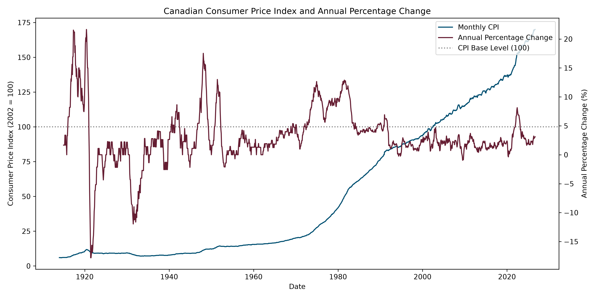

# FINE 3300 Assignment 2: Canadian Inflation Calculator

## Project Overview

This Python program uses monthly Canadian Consumer Price Index (CPI) data to show how prices change between two selected dates. It calculates what a price in Canadian dollars in one month would be equivalent to in another month. The included data covers January 1914 to September 2026.

## Repository Link

[FINE 3300 Assignment 2: Canadian Inflation Calculator](https://github.com/elizabethvassylyev/FINE3300-Assignment-2-Inflation-Calculator)

## Project Files

- `InflationCalculator.py` - Asks for the original price and dates, calculates the results, and saves the graph.
- `STATIC_INFLATIONCALC.csv` - Monthly Canadian CPI data used for the calculations and graph.
- `CPI_Graph.png` - Graph of monthly CPI and the year-over-year percentage change.
- `README.md` - Project description, setup instructions, sample results, and references.

## How It Works

1. The program asks for an original price in CAD and two dates in `YYYY-MM` format. Enter the first date for the original price and the second date you want to compare it with. The second date can be earlier or later.
2. It asks again if the price is not a number greater than zero, if a date is formatted incorrectly, or if the month is invalid or missing from the dataset.
3. It looks up the CPI for both months and multiplies the original price by the second month's CPI divided by the first month's CPI.
4. It displays the adjusted price, total percentage change, time between the dates in months and years, average annual rate of change, and CPI values for both months.

Pandas reads the CSV and looks up the selected months. NumPy calculates the year-over-year CPI changes for the graph, and Matplotlib saves the graph as `CPI_Graph.png`.

## How to Run the Program

1. Download the repository using **Code → Download ZIP**, then unzip it. Keep `InflationCalculator.py` and `STATIC_INFLATIONCALC.csv` in the same folder.
2. Open a terminal in that folder. With Python 3 installed, run:

   ```bash
   python -m pip install pandas numpy matplotlib
   ```

3. Run the calculator:

   ```bash
   python InflationCalculator.py
   ```

4. Enter a price without a dollar sign or commas, then enter both dates. A successful run saves `CPI_Graph.png` in the project folder and replaces any previous copy there.

## CPI Graph and Commentary



The blue line shows the monthly CPI, while the maroon line shows how much the CPI changed compared with the same month a year earlier. The gray dotted line represents the CPI base level of 100, using 2002 as the reference year. I used Bank of Canada colours: BoC Blue (`#004F71`) for CPI and BoC Maroon (`#651D32`) for the annual percentage change.

The CPI rose from 6.0 in January 1914 to 170.0 in September 2026, showing that prices have increased significantly over time. However, inflation was not consistent throughout this period. There were large changes around 1920, negative inflation during the Great Depression in the 1930s, and high inflation during the 1970s and early 1980s. More recently, inflation slowed down during the COVID-19 pandemic in 2020, then increased sharply in 2021 and 2022, before slowing down again. Even when inflation decreased, the CPI generally continued to rise, meaning that prices were still increasing just at a slower rate.

## Sample Calculator Results

```text
Canadian Inflation Calculator

Step 1 | Enter the Original Price in CAD: 1000
Step 2 | Enter the First Date (YYYY-MM): 2003-09
Step 3 | Enter the Second Date (YYYY-MM): 2005-08

---------------------------------------------------------------

Inflation Calculator Results

$1,000.00 CAD in 2003-09 is equal to $1,042.68 CAD in 2005-08

Total Percentage Change: 4.27%
Elapsed Time: 1.92 years (23 months)
Average Annual Rate of Change: 2.20%

CPI for 2003-09: 103.10
CPI for 2005-08: 107.50

---------------------------------------------------------------

CPI Graph Saved as CPI_Graph.png.
```

## References

- FINE 3300 course lecture slides.
- Bank of Canada, [Inflation Calculator](https://www.bankofcanada.ca/rates/related/inflation-calculator/).
- Bank of Canada, [Colour Scheme](https://design.bankofcanada.ca/design/colour-scheme/).
- Statistics Canada, [Consumer Price Index Portal](https://www.statcan.gc.ca/en/subjects-start/prices_and_price_indexes/consumer_price_indexes).
- Bank of Canada, [Understanding the Consumer Price Index](https://www.bankofcanada.ca/2021/05/understanding-consumer-price-index/).
